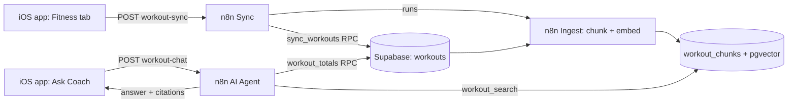

# Workout RAG Agent — Setup Guide

Step-by-step setup for the workout RAG agent (Supabase + pgvector + n8n), built around what The Improvement Mindset's Fitness tab records.

All SQL lives in [`supabase/schema.sql`](supabase/schema.sql). The sections below explain each piece.

**Placeholders:** replace `YOUR_PROJECT` with your Supabase project ref, `YOUR_SECRET` with your webhook key, `rag.yourdomain.com` with your domain, and `America/Chicago` with your time zone.

---

## The MVP

The minimum viable product is the full loop working **from inside the app**:

1. You log, edit or delete a workout in the Fitness tab.
2. The app sends it to Supabase automatically (through n8n), and it's embedded right away.
3. You open the **Ask Coach** screen in the app, ask a question, and get an answer with cited sessions.

No CSV exports, no manual merges, no curl.

| Stage | Steps | Status |
|---|---|---|
| Supabase schema and data | 1–4 | ✅ Done |
| n8n ingest and chat workflows | 5–9 | ✅ Done |
| App sends workouts to Supabase | 10–13, 16 | MVP |
| App talks to the RAG agent | 14–15, 17–18 | MVP |
| Cloud deployment | 19–22 | MVP (needed for a real iPhone) |
| Tests | 23–25 | MVP |
| GitHub, README, demo | 26–28 | Portfolio |



> The app only ever holds the **n8n webhook key**. The Supabase service_role key stays in n8n.

---

## Day 1 — Supabase ✅

### 1. Create the project

supabase.com → **New Project** → name it `workout-rag` → set a strong database password (save it) → choose the closest region → **Create**.

Then go to **Project Settings → API Keys** and copy two things for n8n later:

- the **Project URL** (`https://YOUR_PROJECT.supabase.co`)
- the **service_role / secret key**

> Never put the service_role key in the iOS app or on a public web page. Only n8n should have it.

### 2. Run the schema

Open **SQL Editor → New query**, paste the whole of `supabase/schema.sql`, and click **Run**. It's safe to run again. It does the following:

**2a. Enable pgvector**

```sql
create extension if not exists vector with schema extensions;
```

**2b. The `workouts` table.** Its columns match the app's CSV export exactly.

```sql
create table if not exists public.workouts (
  id               uuid primary key,
  workout_type     text not null
                   check (workout_type in ('fighting', 'soccer', 'lifting', 'strongman', 'dancing', '')),
  duration_minutes int  not null check (duration_minutes >= 0),
  notes            text,
  performed_at     timestamptz not null,
  logged_at        timestamptz not null default now(),
  content          text not null
);
create index if not exists workouts_performed_at_idx on public.workouts (performed_at desc);
create index if not exists workouts_type_idx         on public.workouts (workout_type);
```

**2c. A staging table and merge function.** Every export from the app contains *all* your workouts, so importing directly would fail on duplicate ids. Import into staging instead, then merge; workouts that are already in the table get skipped.

```sql
create table if not exists public.workouts_staging (like public.workouts);

create or replace function public.merge_staged_workouts()
returns int language plpgsql as $$
declare inserted int;
begin
  insert into public.workouts
  select * from public.workouts_staging
  on conflict (id) do nothing;
  get diagnostics inserted = row_count;
  truncate public.workouts_staging;
  return inserted;
end; $$;
```

**2d. The chunks table.** There's one chunk per workout, using 1536 dimensions for OpenAI `text-embedding-3-small`. The index is HNSW instead of ivfflat, because ivfflat works badly on a small, growing table.

```sql
create table if not exists public.workout_chunks (
  id         bigserial primary key,
  content    text not null,
  metadata   jsonb not null default '{}'::jsonb,
  embedding  extensions.vector(1536),
  created_at timestamptz not null default now()
);
create index if not exists workout_chunks_embedding_idx
  on public.workout_chunks using hnsw (embedding extensions.vector_cosine_ops);
create index if not exists workout_chunks_metadata_idx
  on public.workout_chunks using gin (metadata);
```

**2e. The search function.** It uses the signature n8n's Supabase Vector Store node expects, so you don't have to hand-build the search.

```sql
create or replace function public.match_workout_chunks(
  query_embedding extensions.vector(1536),
  match_count     int   default 8,
  filter          jsonb default '{}'
)
returns table (id bigint, content text, metadata jsonb, similarity float)
language sql stable as $$
  select c.id, c.content, c.metadata,
         1 - (c.embedding <=> query_embedding) as similarity
  from public.workout_chunks c
  where c.metadata @> filter
  order by c.embedding <=> query_embedding
  limit match_count;
$$;
```

**2f. A "needs embedding" view.** Re-running the ingestion workflow then never creates duplicate chunks.

```sql
create or replace view public.workouts_to_embed
with (security_invoker = true) as
select w.* from public.workouts w
where not exists (
  select 1 from public.workout_chunks c
  where c.metadata->>'workout_id' = w.id::text
);
```

**2g. Exact totals.** Vector search can't count reliably. "How many hours did I fight in October?" needs real maths, so the agent calls this function as a tool.

```sql
create or replace function public.workout_summary(
  start_date date, end_date date, tz text default 'UTC'
)
returns table (workout_type text, sessions bigint, total_minutes bigint,
               avg_minutes numeric, first_session date, last_session date)
language sql stable as $$
  select coalesce(nullif(w.workout_type, ''), 'unspecified'),
         count(*), sum(w.duration_minutes), round(avg(w.duration_minutes), 1),
         min((w.performed_at at time zone tz)::date),
         max((w.performed_at at time zone tz)::date)
  from public.workouts w
  where (w.performed_at at time zone tz)::date between start_date and end_date
  group by 1 order by 3 desc;
$$;
```

**2h. Delete sync and security**

```sql
create or replace function public.delete_workout_chunks()
returns trigger language plpgsql as $$
begin
  delete from public.workout_chunks where metadata->>'workout_id' = old.id::text;
  return old;
end; $$;

drop trigger if exists workouts_delete_chunks on public.workouts;
create trigger workouts_delete_chunks
  after delete on public.workouts
  for each row execute function public.delete_workout_chunks();

alter table public.workouts         enable row level security;
alter table public.workouts_staging enable row level security;
alter table public.workout_chunks   enable row level security;
```

With row-level security on and no policies, the public key can't read anything. n8n's service_role key bypasses this.

### 3. Get your workouts in

> Once the app sync (steps 10–16) is running, you don't need this step any more: the app's first sync sends every workout you have. Keep it as a fallback.

1. In the app, go to **Fitness → export icon (top right)** and AirDrop or save `workouts.csv` to your Mac.
2. In Supabase, open **Table Editor → `workouts_staging` → Insert → Import data from CSV**, upload the file and confirm the columns line up.
3. In the SQL Editor:

   ```sql
   select public.merge_staged_workouts();   -- returns how many NEW workouts were added
   ```

### 4. Check it

```sql
select workout_type, duration_minutes, content from public.workouts order by performed_at desc limit 5;
select * from public.workout_summary('2026-10-01', '2026-10-31', 'America/Chicago');
```

---

## Days 2–3 — n8n ✅

### 5. Run n8n locally

```bash
docker run -it --rm -p 5678:5678 -v n8n_data:/home/node/.n8n docker.n8n.io/n8nio/n8n
```

Open http://localhost:5678 and create the owner account.

**Credentials** (left menu → Credentials → Add):

- **Supabase API:** Host `https://YOUR_PROJECT.supabase.co`, plus the service_role key.
- **OpenAI:** your API key.

### 6. Workflow 1: "Workout Ingest"

| # | Node | Settings |
|---|---|---|
| 1 | **Manual Trigger** and **Schedule Trigger** (daily) | Both connect to node 2 |
| 2 | **Supabase** | Operation: *Get Many*; Table: `workouts_to_embed`; Return All: on |
| 3 | **Code** (JavaScript, "Run Once for All Items") | Code below |
| 4 | **Supabase Vector Store** | Operation: *Insert Documents*; Table: `workout_chunks` |
| 4a | ↳ **Embeddings OpenAI** | Model: `text-embedding-3-small` |
| 4b | ↳ **Default Data Loader** | Type: JSON; Mode: *Load Specific Data*; Data: `{{ $json.content }}`; Text Splitting: Simple. Under Options → Metadata add `workout_id` = `{{ $json.workout_id }}`, `workout_type` = `{{ $json.workout_type }}`, `duration_minutes` = `{{ $json.duration_minutes }}`, `performed_at` = `{{ $json.performed_at }}` |

**Code node.** Commit this to GitHub as `chunking/build_chunks.js`. The app already writes the readable sentence into `content`, so this step mainly tidies the fields and fills in gaps:

```javascript
// One chunk per workout. `content` is built by the iOS app, e.g.
// "Monday, October 20, 2026 — Fighting session, 1 hr 15 min. Notes: sparred 5 rounds."
const label = (t) => (t ? t[0].toUpperCase() + t.slice(1) : 'Unspecified');
const fmt = (m) => (m >= 60 ? `${Math.floor(m / 60)} hr${m % 60 ? ` ${m % 60} min` : ''}` : `${m} min`);

return $input.all().map(({ json: w }) => {
  const type = w.workout_type || 'unspecified';
  // Fallback in case a row was inserted without content
  const content = w.content?.trim() ||
    `${new Date(w.performed_at).toDateString()} — ${label(w.workout_type)} session, ${fmt(w.duration_minutes)}.` +
    (w.notes ? ` Notes: ${w.notes}` : '');

  return {
    json: {
      content,
      workout_id: w.id,
      workout_type: type,
      duration_minutes: w.duration_minutes,
      performed_at: w.performed_at,
    },
  };
});
```

### 7. Run it and verify

Click **Execute Workflow**, then run:

```sql
select content, metadata from public.workout_chunks order by id desc limit 5;
select count(*) from public.workouts_to_embed;   -- should be 0
```

### 8. Workflow 2: "Workout Chat"

| # | Node | Settings |
|---|---|---|
| 1 | **Webhook** | Method: POST; Path: `workout-chat`; Authentication: *Header Auth* (Name `X-API-Key`, Value: a long random string); Respond: *Using 'Respond to Webhook' Node* |
| 2 | **AI Agent** | Source for Prompt: *Define below* → `{{ $json.body.question }}`; System Message below |
| 2a | ↳ **OpenAI Chat Model** | `gpt-4o-mini` is plenty |
| 2b | ↳ **Supabase Vector Store** (tool) | Operation: *Retrieve Documents (As Tool for AI Agent)*; Name: `workout_search`; Description: "Find individual workout logs by meaning: what happened, how sessions felt, specific notes."; Table: `workout_chunks`; Limit: 8; Include Metadata: on; Options → Query Name: `match_workout_chunks` |
| 2c | ↳↳ **Embeddings OpenAI** | `text-embedding-3-small` (it **must** match Workflow 1) |
| 2d | ↳ **HTTP Request Tool** | Name: `workout_totals`; Description: "Exact session counts and total/average minutes per workout type for a date range. Use for ANY how many / how much / how often / comparison question."; Method: POST; URL: `https://YOUR_PROJECT.supabase.co/rest/v1/rpc/workout_summary`; Authentication: Predefined → Supabase API; Body (JSON) below |
| 3 | **Respond to Webhook** | Respond With: JSON → `{ "answer": {{ JSON.stringify($json.output) }} }` |

**HTTP tool body**

```
{
  "start_date": "{{ $fromAI('start_date', 'First day of range, YYYY-MM-DD', 'string') }}",
  "end_date": "{{ $fromAI('end_date', 'Last day of range inclusive, YYYY-MM-DD', 'string') }}",
  "tz": "America/Chicago"
}
```

**System message**

```
You are the training coach inside The Improvement Mindset app.
Today is {{ $now.setZone('America/Chicago').toFormat('cccc, LLLL d, yyyy') }}.

The user logs exactly 5 workout types: fighting, soccer, lifting, strongman, dancing.
Each log has a type, a duration in minutes, a date, and optional notes about what happened.

Tools:
- workout_totals: exact counts and minutes per type for a date range. ALWAYS use it for
  how many / how much / how often / totals / averages / comparisons. Never count by hand.
- workout_search: finds individual sessions. Use it for what happened, how it felt, notes, examples.

Rules:
- Answer ONLY from tool results. If it isn't logged, say "I don't have that logged."
- Cite sessions like "(Tue Oct 14 — Fighting, 60 min)".
- Show durations in hours and minutes. Be concise.
```

### 9. Test it

Turn the workflow on (the **Active** toggle) and run:

```bash
curl -X POST http://localhost:5678/webhook/workout-chat \
  -H "Content-Type: application/json" \
  -H "X-API-Key: YOUR_SECRET" \
  -d '{"question": "How many hours did I spend fighting this month?"}'
```

Use `/webhook-test/` instead of `/webhook/` while you're testing in the editor with "Listen for test event".

---

## Day 4 — The app talks to the RAG (MVP)

The app sends workouts to an n8n webhook rather than straight to Supabase. That way the app only needs the same webhook key it uses for chat, and n8n can embed the new workout immediately so the coach knows about it seconds after you log it.

The sync is deliberately simple: **every sync sends all workouts**, plus the ids of any you deleted. The database skips workouts that haven't changed, so only new or edited ones get re-embedded. Because each sync sends everything, a sync that fails while you're offline is fixed by the next one.

### 10. Add the sync function

Append this to `supabase/schema.sql` and run it in the SQL Editor:

```sql
-- Called by the n8n "Workout Sync" workflow with everything the app has.
-- upserts: [{ id, workout_type, duration_minutes, notes, performed_at, content }, ...]
-- deletes: ["uuid", ...]
create or replace function public.sync_workouts(
  upserts jsonb default '[]',
  deletes jsonb default '[]'
)
returns jsonb language plpgsql as $$
declare changed int; removed int;
begin
  with incoming as (
    select * from jsonb_to_recordset(upserts) as r(
      id uuid, workout_type text, duration_minutes int, notes text,
      performed_at timestamptz, content text)
  ), up as (
    insert into public.workouts as w
      (id, workout_type, duration_minutes, notes, performed_at, content)
    select id, coalesce(workout_type, ''), duration_minutes, nullif(notes, ''), performed_at, content
    from incoming
    on conflict (id) do update set
      workout_type     = excluded.workout_type,
      duration_minutes = excluded.duration_minutes,
      notes            = excluded.notes,
      performed_at     = excluded.performed_at,
      content          = excluded.content
    -- Unchanged workouts are skipped, so they keep their existing embedding
    where (w.workout_type, w.duration_minutes, w.notes, w.performed_at, w.content)
          is distinct from
          (excluded.workout_type, excluded.duration_minutes, excluded.notes,
           excluded.performed_at, excluded.content)
    returning w.id
  ), stale as (
    -- Edited workouts lose their old chunk, so workouts_to_embed picks them up again
    delete from public.workout_chunks c using up
    where c.metadata->>'workout_id' = up.id::text
  )
  select count(*) into changed from up;

  -- The delete trigger from 2h removes their chunks
  delete from public.workouts
  where id in (select (jsonb_array_elements_text(deletes))::uuid);
  get diagnostics removed = row_count;

  return jsonb_build_object('changed', changed, 'removed', removed);
end; $$;

-- Only n8n (service_role) may call it
revoke execute on function public.sync_workouts(jsonb, jsonb) from public, anon, authenticated;
grant  execute on function public.sync_workouts(jsonb, jsonb) to service_role;
```

### 11. Let Workflow 1 be run by another workflow

Open **Workout Ingest** and add a third trigger: **When Executed by Another Workflow** (also called *Execute Workflow Trigger*), with Input data mode: *Accept all data*. Connect it to node 2 (the Supabase *Get Many*), alongside the Manual and Schedule triggers. Save.

Keep the daily Schedule Trigger as a safety net in case an embed ever fails.

### 12. Workflow 3: "Workout Sync"

| # | Node | Settings |
|---|---|---|
| 1 | **Webhook** | Method: POST; Path: `workout-sync`; Authentication: *Header Auth* (pick the **same** credential as Workflow 2); Respond: *Using 'Respond to Webhook' Node* |
| 2 | **HTTP Request** | Name: `Sync to Supabase`; Method: POST; URL: `https://YOUR_PROJECT.supabase.co/rest/v1/rpc/sync_workouts`; Authentication: Predefined → Supabase API; Send Body: on; Body Content Type: JSON; Specify Body: *Using JSON*; body below |
| 3 | **Execute Workflow** (*Execute Sub-workflow*) | Workflow: *From list* → `Workout Ingest`; Wait for Sub-Workflow Completion: on. Under the node's **Settings** turn on **Always Output Data** (when nothing needs embedding the sub-workflow returns no items, and without this the webhook would never reply) |
| 4 | **Respond to Webhook** | Respond With: JSON → `{{ JSON.stringify($('Sync to Supabase').first().json) }}` |

**HTTP Request body**

```
{
  "upserts": {{ JSON.stringify($json.body.upserts ?? []) }},
  "deletes": {{ JSON.stringify($json.body.deletes ?? []) }}
}
```

Turn the workflow **Active**.

### 13. Test sync with curl

In both commands below, replace `YOUR_SECRET` with the real Header Auth value from step 8, and copy only what's inside the code block.

Add a fake workout:

```bash
curl -X POST http://localhost:5678/webhook/workout-sync \
  -H "Content-Type: application/json" \
  -H "X-API-Key: YOUR_SECRET" \
  -d '{"upserts":[{"id":"00000000-0000-0000-0000-000000000001","workout_type":"soccer","duration_minutes":45,"notes":"curl test","performed_at":"2026-10-28T18:00:00Z","content":"Wednesday, October 28, 2026 — Soccer session, 45 min. Notes: curl test."}],"deletes":[]}'
```

It should return `{"changed":1,"removed":0}`. Run the same command again and it should return `"changed":0`. Check that it was embedded:
writers pla

```sql
select content from public.workout_chunks where metadata->>'workout_id' = '00000000-0000-0000-0000-000000000001';
```

Then delete it:

```bash
curl -X POST http://localhost:5678/webhook/workout-sync \
  -H "Content-Type: application/json" \
  -H "X-API-Key: YOUR_SECRET" \
  -d '{"upserts":[],"deletes":["00000000-0000-0000-0000-000000000001"]}'
```

It should return `{"changed":0,"removed":1}`.

### 14. App: point it at n8n

Keep the URL and key out of Git with an xcconfig file.

1. **File → New → File → Configuration Settings File**, name it `Secrets.xcconfig`, and add it to `.gitignore`.

   ```
   // `//` starts a comment in xcconfig files, so the URL uses $() to break it up
   RAG_BASE_URL = http:/$()/localhost:5678/
   RAG_API_KEY = YOUR_SECRET
   ```

2. Select the project → **Info** tab → **Configurations**, and set `Secrets` as the configuration file for the app target in both Debug and Release.
3. Select the app target → **Info** tab → add two custom keys:

   | Key | Type | Value |
   |---|---|---|
   | `RAGBaseURL` | String | `$(RAG_BASE_URL)` |
   | `RAGAPIKey` | String | `$(RAG_API_KEY)` |

`localhost` only works in the **Simulator** (it shares your Mac's network). For a real iPhone you need the deployed server from Day 5. If the Simulator reports an App Transport Security error for `http://localhost`, add `NSAppTransportSecurity → NSAllowsLocalNetworking = YES` while you develop.

> The webhook key ships inside the app, so anyone who pulls apart the binary could find it. That's fine for a personal app; see *After the MVP* for per-user auth.

### 15. App: `RAGClient.swift`

One small client for both webhooks:

```swift
import Foundation

/// The shape the `workout-sync` webhook expects. Keys are sent as snake_case,
/// matching the columns of `public.workouts`.
struct WorkoutPayload: Codable, Sendable {
    let id: UUID
    let workoutType: String
    let durationMinutes: Int
    let notes: String
    let performedAt: Date
    let content: String
}

enum RAGError: LocalizedError {
    case notConfigured
    case badResponse(Int)

    var errorDescription: String? {
        switch self {
        case .notConfigured: "The coach isn't set up. Check RAGBaseURL and RAGAPIKey in Info.plist."
        case .badResponse(let status): "The coach server returned an error (\(status))."
        }
    }
}

/// Talks to the n8n webhooks. The base URL and key come from Info.plist,
/// which reads them from Secrets.xcconfig.
struct RAGClient: Sendable {
    static let shared = RAGClient()

    private let baseURL: URL?
    private let apiKey: String

    init(bundle: Bundle = .main) {
        baseURL = (bundle.object(forInfoDictionaryKey: "RAGBaseURL") as? String).flatMap(URL.init(string:))
        apiKey = bundle.object(forInfoDictionaryKey: "RAGAPIKey") as? String ?? ""
    }

    /// Sends every workout plus the ids of deleted ones.
    func sync(upserts: [WorkoutPayload], deletes: [UUID]) async throws {
        struct Body: Encodable {
            let upserts: [WorkoutPayload]
            let deletes: [UUID]
        }
        _ = try await post("webhook/workout-sync", body: Body(upserts: upserts, deletes: deletes))
    }

    /// Asks the coach a question and returns its answer.
    func ask(_ question: String) async throws -> String {
        struct Body: Encodable { let question: String }
        struct Reply: Decodable { let answer: String }
        let data = try await post("webhook/workout-chat", body: Body(question: question))
        return try JSONDecoder().decode(Reply.self, from: data).answer
    }

    private func post(_ path: String, body: some Encodable) async throws -> Data {
        guard let baseURL, !apiKey.isEmpty else { throw RAGError.notConfigured }

        let encoder = JSONEncoder()
        encoder.keyEncodingStrategy = .convertToSnakeCase
        encoder.dateEncodingStrategy = .iso8601

        var request = URLRequest(url: baseURL.appending(path: path))
        request.httpMethod = "POST"
        request.timeoutInterval = 60   // the agent can take a few seconds
        request.setValue("application/json", forHTTPHeaderField: "Content-Type")
        request.setValue(apiKey, forHTTPHeaderField: "X-API-Key")
        request.httpBody = try encoder.encode(body)

        let (data, response) = try await URLSession.shared.data(for: request)
        let status = (response as? HTTPURLResponse)?.statusCode ?? 0
        guard (200..<300).contains(status) else { throw RAGError.badResponse(status) }
        return data
    }
}
```

### 16. App: `WorkoutSync.swift`, then hook it in

This maps your SwiftData workouts to payloads and remembers deletes until they've been sent. **Adjust the property names in `init(_ workout:)` to match your `Workout` model**, and use the same code your CSV export uses to build `content`, so the sentence the coach reads is identical.

```swift
import Foundation
import SwiftData

extension WorkoutPayload {
    // ⚠️ Rename these to match your Workout model.
    init(_ workout: Workout) {
        self.init(
            id: workout.id,
            workoutType: workout.type?.rawValue ?? "",   // "fighting", "soccer", … or ""
            durationMinutes: workout.durationMinutes,
            notes: workout.notes,
            performedAt: workout.date,
            content: workout.csvContent                   // the same sentence the CSV export writes
        )
    }
}

/// Pushes the Fitness tab's workouts to Supabase (through n8n) so the coach can see them.
@MainActor
enum WorkoutSync {
    private static let pendingDeletesKey = "WorkoutSync.pendingDeletes"

    /// Call just before deleting a workout from SwiftData.
    static func markDeleted(_ id: UUID) {
        var ids = UserDefaults.standard.stringArray(forKey: pendingDeletesKey) ?? []
        ids.append(id.uuidString)
        UserDefaults.standard.set(ids, forKey: pendingDeletesKey)
    }

    /// Sends every workout plus any pending deletes. Safe to call often:
    /// unchanged workouts are skipped on the server and aren't re-embedded.
    static func run(context: ModelContext) async {
        do {
            let workouts = try context.fetch(FetchDescriptor<Workout>())
            let sentDeletes = UserDefaults.standard.stringArray(forKey: pendingDeletesKey) ?? []

            try await RAGClient.shared.sync(
                upserts: workouts.map(WorkoutPayload.init),
                deletes: sentDeletes.compactMap(UUID.init(uuidString:))
            )

            // Clear only what was sent, in case another delete happened during the request
            let remaining = (UserDefaults.standard.stringArray(forKey: pendingDeletesKey) ?? [])
                .filter { !sentDeletes.contains($0) }
            UserDefaults.standard.set(remaining, forKey: pendingDeletesKey)
        } catch {
            // Offline or server down: nothing is lost, the next sync sends everything again
            print("Workout sync failed: \(error.localizedDescription)")
        }
    }
}
```

Hook it into the Fitness tab in three places (with `@Environment(\.modelContext) private var modelContext` in each view):

```swift
// 1. After saving a new or edited workout
try modelContext.save()
Task { await WorkoutSync.run(context: modelContext) }

// 2. When deleting a workout
WorkoutSync.markDeleted(workout.id)
modelContext.delete(workout)
Task { await WorkoutSync.run(context: modelContext) }

// 3. When the Fitness tab appears, to catch up after being offline
.task { await WorkoutSync.run(context: modelContext) }
```

The first time this runs, it sends every workout you've ever logged, which replaces the CSV import from step 3.

### 17. App: `AskCoachView.swift`

A native chat screen that calls the chat webhook:

```swift
import SwiftUI

struct AskCoachView: View {
    private struct Message: Identifiable {
        let id = UUID()
        let isFromUser: Bool
        let text: String
    }

    @State private var messages: [Message] = []
    @State private var question = ""
    @State private var isThinking = false

    var body: some View {
        NavigationStack {
            ScrollViewReader { proxy in
                ScrollView {
                    LazyVStack(alignment: .leading, spacing: 12) {
                        ForEach(messages) { message in
                            Text(message.text)
                                .textSelection(.enabled)
                                .padding(12)
                                .background(
                                    message.isFromUser ? Color.accentColor.opacity(0.2) : Color.secondary.opacity(0.15),
                                    in: .rect(cornerRadius: 12)
                                )
                                .frame(maxWidth: .infinity, alignment: message.isFromUser ? .trailing : .leading)
                                .id(message.id)
                        }
                        if isThinking {
                            ProgressView()
                                .padding(.leading, 12)
                        }
                    }
                    .padding()
                }
                .onChange(of: messages.count) {
                    if let last = messages.last {
                        withAnimation { proxy.scrollTo(last.id, anchor: .bottom) }
                    }
                }
            }
            .overlay {
                if messages.isEmpty {
                    ContentUnavailableView(
                        "Ask about your training",
                        systemImage: "figure.run",
                        description: Text("Try “How many hours did I fight this month?”")
                    )
                }
            }
            .safeAreaInset(edge: .bottom) {
                HStack {
                    TextField("Ask about your training…", text: $question)
                        .textFieldStyle(.roundedBorder)
                        .submitLabel(.send)
                        .onSubmit(send)
                    Button("Send", systemImage: "arrow.up.circle.fill", action: send)
                        .labelStyle(.iconOnly)
                        .font(.title2)
                        .disabled(trimmedQuestion.isEmpty || isThinking)
                }
                .padding()
                .background(.bar)
            }
            .navigationTitle("Ask Coach")
        }
    }

    private var trimmedQuestion: String {
        question.trimmingCharacters(in: .whitespacesAndNewlines)
    }

    private func send() {
        let text = trimmedQuestion
        guard !text.isEmpty, !isThinking else { return }

        question = ""
        messages.append(Message(isFromUser: true, text: text))
        isThinking = true

        Task {
            let reply: String
            do {
                reply = try await RAGClient.shared.ask(text)
            } catch {
                reply = "Couldn't reach the coach: \(error.localizedDescription)"
            }
            messages.append(Message(isFromUser: false, text: reply))
            isThinking = false
        }
    }
}
```

Open it from the Fitness tab with a toolbar button:

```swift
@State private var showingCoach = false

// in the Fitness view's toolbar
Button("Ask Coach", systemImage: "bubble.left.and.text.bubble.right") { showingCoach = true }

// on the Fitness view
.sheet(isPresented: $showingCoach) { AskCoachView() }
```

### 18. End-to-end check (Simulator)

With n8n running locally and all three workflows **Active**:

1. Run the app in the Simulator and open the Fitness tab (this triggers the first full sync).
2. In Supabase, `select count(*) from public.workouts;` should match the number of workouts in the app, and `select count(*) from public.workouts_to_embed;` should be 0.
3. Log a new workout with a distinctive note, e.g. "worked on left hook to the body".
4. Open **Ask Coach** and ask "What did I work on in my last fighting session?" The answer should mention the left hook and cite today's date.
5. Ask "How many workouts did I log this week?" and check the number.
6. Delete that workout in the app, ask again, and it should be gone.

If you get this far, the MVP works locally.

---

## Day 5 — Cloud (so it works on your iPhone)

### 19. Server

Get a $5–6/month VPS (Hetzner, DigitalOcean), SSH in and run:

```bash
curl -fsSL https://get.docker.com | sh
```

### 20. n8n and HTTPS

The older `N8N_BASIC_AUTH_*` settings were removed in n8n 1.x. Login is now the owner account you create on first visit.

`~/n8n/docker-compose.yml`:

```yaml
services:
  n8n:
    image: docker.n8n.io/n8nio/n8n
    restart: unless-stopped
    environment:
      - N8N_HOST=rag.yourdomain.com
      - N8N_PROTOCOL=https
      - WEBHOOK_URL=https://rag.yourdomain.com/
      - GENERIC_TIMEZONE=America/Chicago
      - TZ=America/Chicago
      - N8N_ENCRYPTION_KEY=${N8N_ENCRYPTION_KEY}
    volumes:
      - n8n_data:/home/node/.n8n
  caddy:
    image: caddy:2
    restart: unless-stopped
    ports: ["80:80", "443:443"]
    volumes:
      - ./Caddyfile:/etc/caddy/Caddyfile
      - caddy_data:/data
volumes:
  n8n_data:
  caddy_data:
```

`~/n8n/Caddyfile`:

```
rag.yourdomain.com {
    reverse_proxy n8n:5678
}
```

`~/n8n/.env`: `N8N_ENCRYPTION_KEY=` followed by the output of `openssl rand -hex 32`.

Then run:

```bash
docker compose up -d
```

### 21. DNS and moving workflows

- Add a DNS **A record** pointing `rag` at the server's IP. Caddy gets the HTTPS certificate automatically.
- On your local n8n, open each of the **three** workflows' **⋯ menu → Download**, then **Import from File** on the server. Import *Workout Ingest* first.
- Credentials don't export, so re-create the Supabase and OpenAI credentials and the Header Auth on the server.
- In **Workout Sync**, open the Execute Workflow node and re-select `Workout Ingest`. It points to a workflow id, which is different on the server.
- Turn all three workflows **Active**.

### 22. Point the app at production

In `Secrets.xcconfig`:

```
RAG_BASE_URL = https:/$()/rag.yourdomain.com/
RAG_API_KEY = YOUR_SECRET
```

Remove the `NSAllowsLocalNetworking` exception if you added it, run the app on your iPhone, and repeat the check from step 18.

**Optional: standalone portfolio page.** For people without the app, `chat-page/index.html`:

```html
<!doctype html><meta charset="utf-8"><title>Workout Coach</title>
<style>body{font:16px system-ui;max-width:640px;margin:40px auto;background:#0A0E1F;color:#E8DCC0}
#log p{white-space:pre-wrap}input{width:75%;padding:8px}button{padding:8px 14px}</style>
<div id="log"></div>
<input id="q" placeholder="Ask about your training…"><button onclick="ask()">Send</button>
<script>
const URL = "https://rag.yourdomain.com/webhook/workout-chat";
const KEY = "YOUR_SECRET"; // visible to anyone who opens this page; fine for a personal demo only
async function ask() {
  const q = document.getElementById("q").value; if (!q) return;
  log("You: " + q);
  const r = await fetch(URL, { method: "POST",
    headers: { "Content-Type": "application/json", "X-API-Key": KEY },
    body: JSON.stringify({ question: q }) });
  log("Coach: " + (await r.json()).answer);
}
function log(t){ const p=document.createElement("p"); p.textContent=t; document.getElementById("log").append(p); }
</script>
```

A browser page calling n8n directly also needs CORS allowed. In the chat Webhook node, set **Options → Allowed Origins** to your page's domain. The app doesn't need this.

---

## Day 6 — Tests

### 23. `tests/test_questions.json`

First find the true answers from your own data:

```sql
select * from public.workout_summary('2026-10-01', '2026-10-31', 'America/Chicago');
select content from public.workouts where notes ilike '%spar%';
```

Then write 15–20 entries of these kinds (the values here are examples; use your real numbers):

```json
[
  { "question": "How many fighting sessions did I do in October 2026?",
    "expected_answer_contains": ["fight", "4"] },
  { "question": "How many total hours of soccer did I play in October?",
    "expected_answer_contains": ["soccer", "6"] },
  { "question": "Which workout type did I spend the most time on this month?",
    "expected_answer_contains": ["lifting"] },
  { "question": "When was the last time I did strongman?",
    "expected_answer_contains": ["strongman", "Oct"] },
  { "question": "What did I work on in my last sparring session?",
    "expected_answer_contains": ["jab"] },
  { "question": "Did I do any swimming?",
    "expected_answer_contains": ["don't have"] }
]
```

- **Counts and totals** test the `workout_totals` tool.
- **"Most time on" questions** test comparisons.
- **"Last time" questions** test dates.
- **Notes questions** test vector search.
- **Things you never do** test that the agent refuses to make things up.

### 24. `tests/run_tests.py`

Standard library only, nothing to install:

```python
import json, os, sys, urllib.request

URL = os.environ["RAG_URL"]   # e.g. https://rag.yourdomain.com/webhook/workout-chat
KEY = os.environ["RAG_KEY"]

def ask(question):
    req = urllib.request.Request(
        URL, data=json.dumps({"question": question}).encode(),
        headers={"Content-Type": "application/json", "X-API-Key": KEY})
    with urllib.request.urlopen(req, timeout=60) as r:
        return json.load(r)["answer"]

with open(os.path.join(os.path.dirname(__file__), "test_questions.json")) as f:
    tests = json.load(f)

passed = 0
for t in tests:
    answer = ask(t["question"])
    missing = [k for k in t["expected_answer_contains"] if k.lower() not in answer.lower()]
    passed += not missing
    print(f"{'PASS' if not missing else 'FAIL'}  {t['question']}")
    if missing:
        print(f"      missing: {missing}\n      got: {answer[:200]}")

print(f"\n{passed}/{len(tests)} passed")
sys.exit(0 if passed == len(tests) else 1)
```

Run it:

```bash
RAG_URL=https://rag.yourdomain.com/webhook/workout-chat RAG_KEY=YOUR_SECRET python3 tests/run_tests.py
```

### 25. Likely failures and fixes

| Symptom | Fix |
|---|---|
| Wrong counts or totals | The agent searched instead of calling `workout_totals`. Strengthen that tool's description and the "ALWAYS use" line. |
| Dates off by one day | The `tz` in the HTTP tool body and the `$now.setZone(...)` zone don't match your real time zone. |
| "This month" or "last week" is wrong | Today's date is missing from the system message. |
| Notes questions miss things | Raise Limit from 8 to 15, or write more detail in the app's notes field. |
| No results at all | The embedding model differs between Workflow 1 and Workflow 2. |
| A workout logged in the app is missing | Check the Xcode console for "Workout sync failed". Make sure **Workout Sync** is Active, and look at its **Executions** list in n8n. |
| App says "The coach isn't set up" | `RAGBaseURL` / `RAGAPIKey` are empty: `Secrets.xcconfig` isn't assigned to the target, or the Info keys are misspelled. |
| App gets error 403 | The `RAG_API_KEY` doesn't match the Header Auth value in n8n. |
| App gets error 404 | The workflow isn't Active, or the URL is missing the trailing `/` in `RAG_BASE_URL`. |
| Sync request hangs, then times out | **Always Output Data** is off on the Execute Workflow node in Workout Sync. |
| Sync returns an error about `workout_type` | The app sent a type that isn't one of the five lowercase values (or `""`). Check `WorkoutPayload.init(_:)`. |
| Edited workout still shows old details | The edit didn't call `WorkoutSync.run`, so the old chunk was never replaced. |

---

## Day 7 — GitHub, README, demo

### 26. Repo layout (`workout-rag-bot`)

```
schema.sql                     ← copy of supabase/schema.sql (including sync_workouts)
n8n-workflows/ingest.json      ← exported Workflow 1
n8n-workflows/chat.json        ← exported Workflow 2
n8n-workflows/sync.json        ← exported Workflow 3
chunking/build_chunks.js
ios/RAGClient.swift            ← copies of the app files, for reviewers
ios/WorkoutSync.swift
ios/AskCoachView.swift
tests/test_questions.json
tests/run_tests.py
chat-page/index.html
docker-compose.yml
Caddyfile
README.md
```

Before you commit, search the exported workflow JSON for keys. Credentials aren't exported, but check anyway. Add `.env` and `Secrets.xcconfig` to `.gitignore` in both this repo and the app's repo.

### 27. README

Use the architecture diagram from **The MVP** section at the top of this guide.

- **Tech stack:** Swift/SwiftUI/SwiftData, Supabase Postgres + pgvector (HNSW), n8n AI Agent (LangChain-based), OpenAI `text-embedding-3-small` + `gpt-4o-mini`, Docker, Caddy.
- **The points worth explaining:**
  - The agent has two tools. Semantic search handles the "what happened" questions, and a SQL function handles the counting questions, which plain RAG gets wrong.
  - The app syncs by sending its full workout list. The database skips unchanged rows, so only new and edited workouts are re-embedded, and a failed sync is fixed by the next one.
  - The app never holds a database key. It only knows the webhook key, and n8n holds the service_role key.

### 28. Demo video (60 seconds)

1. Log a workout in the app with a memorable note.
2. Open **Ask Coach** straight away and ask about that note. The coach finds it, with no export or manual step.
3. Ask one counting question, e.g. "How many hours did I train this month?"
4. Show the cited dates matching your logs in the Fitness tab.

---

## After the MVP

- **Per-user auth:** replace the shared webhook key with Sign in with Apple + Supabase Auth, add a `user_id` column and RLS policies, and have n8n verify the user's token.
- **Conversation memory:** send a `session_id` from `AskCoachView` and add a **Simple Memory** (or Postgres Chat Memory) node to the AI Agent, so follow-up questions like "and the week before?" work.
- **Incremental sync:** once you have hundreds of workouts, send only the workouts changed since the last successful sync instead of the full list.
- **Streaming answers:** stream the agent's reply so long answers appear word by word.
